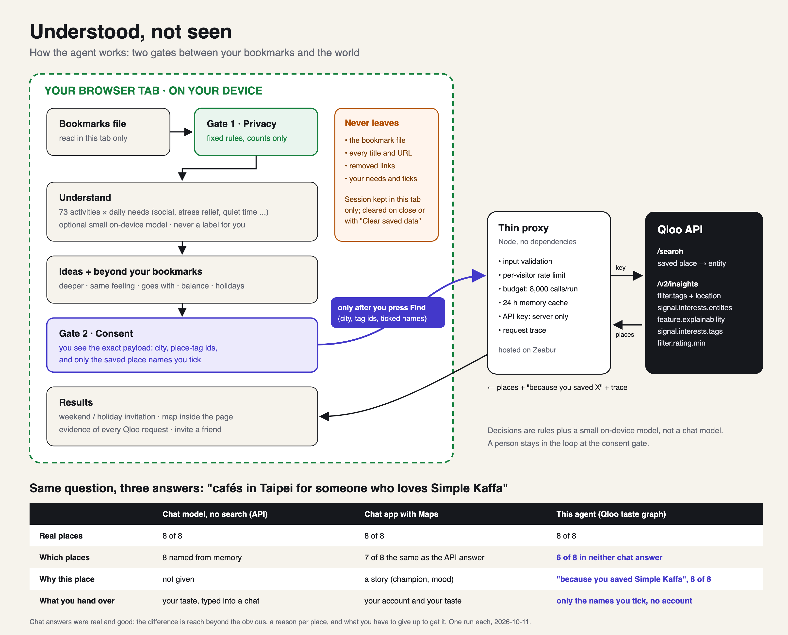
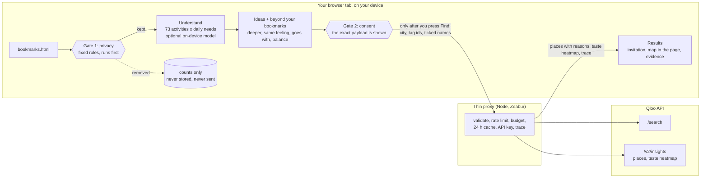
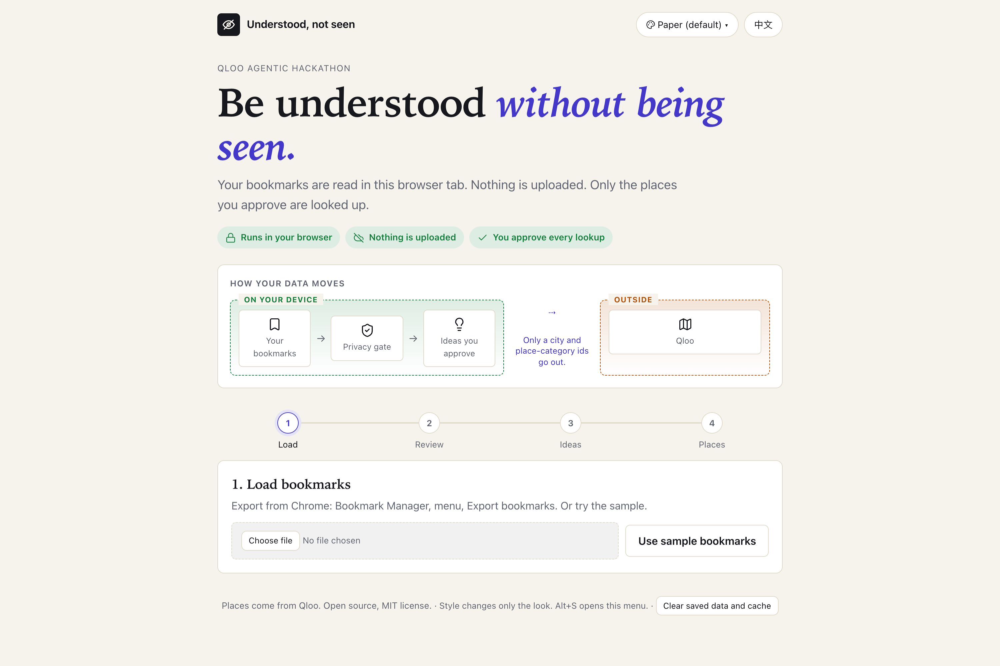
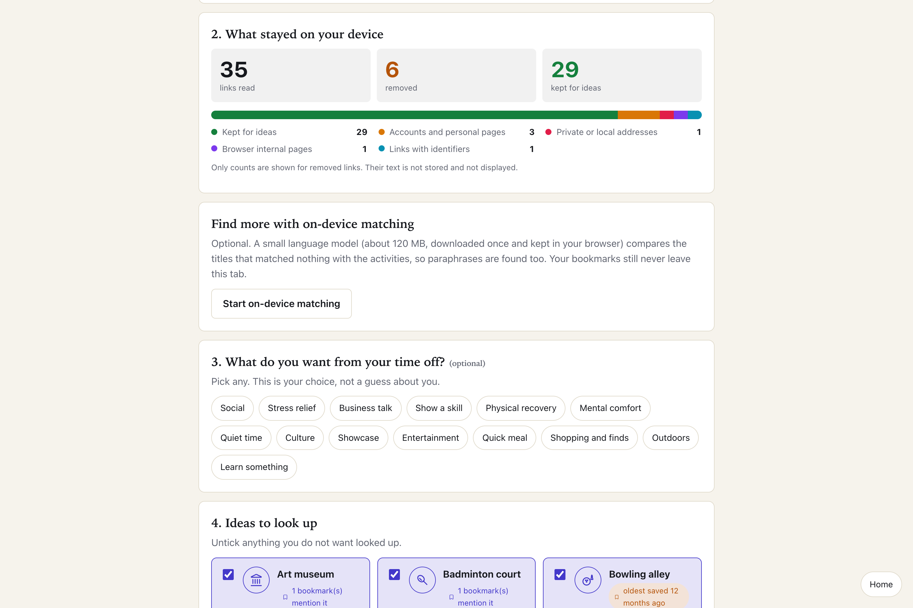
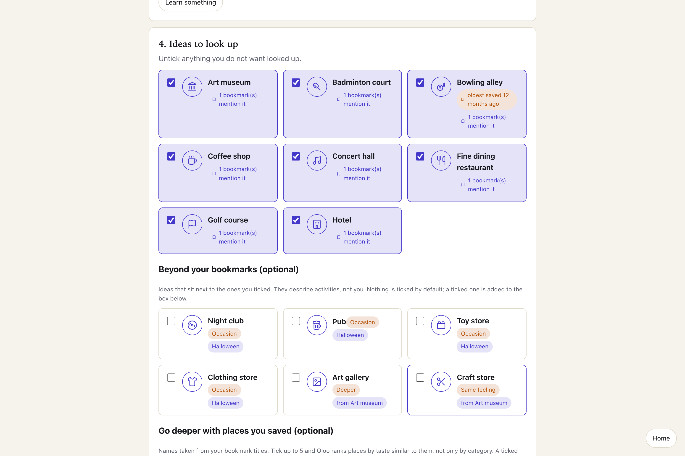
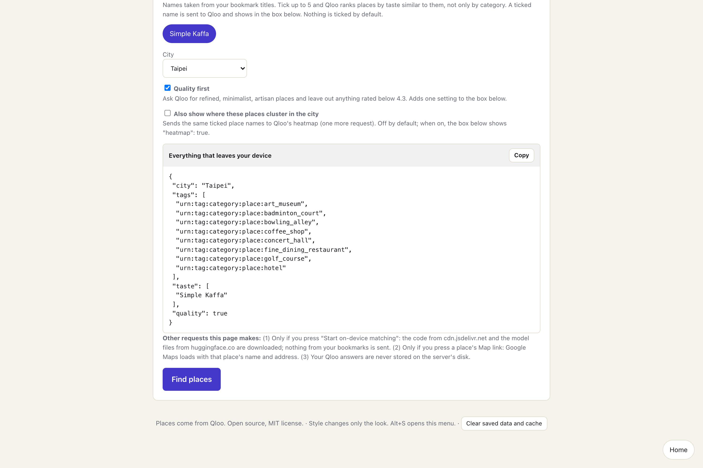
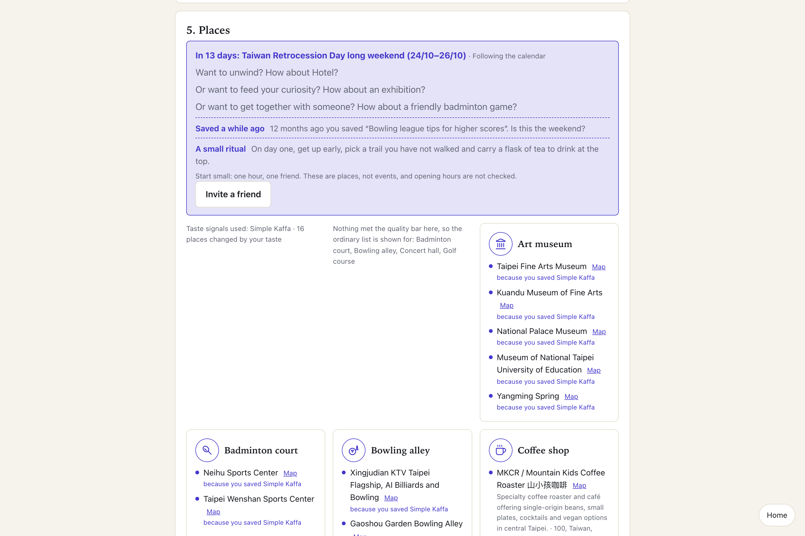
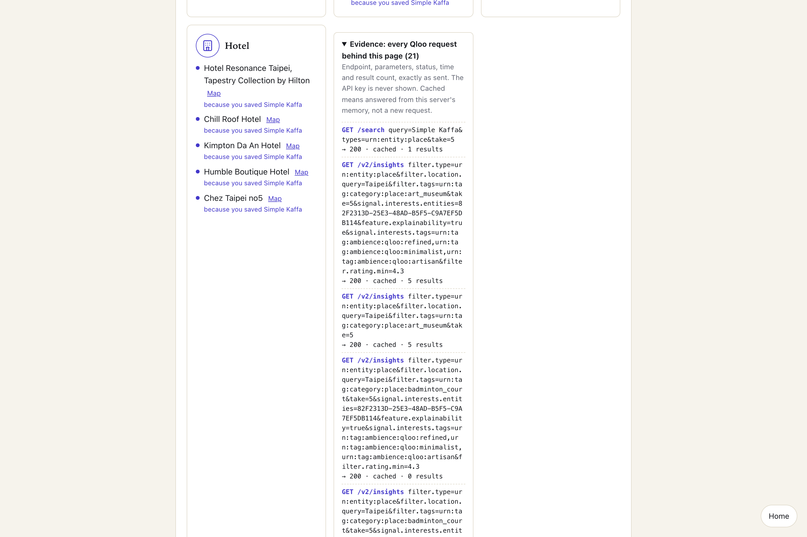

# Understood, not seen

Turn your bookmarks into place ideas **without uploading them**.

Most "personalised" tools ask you to hand over your history first. This one reads your bookmark export inside your own
browser tab, removes anything private on the spot, and sends only a short list of public place categories plus a city to
[Qloo](https://www.qloo.com)'s taste graph. You see exactly what would leave your device before you press the button.

> Built for the Qloo Agentic Hackathon. License: MIT. Interface in English and Traditional Chinese, bookmark titles in either language, light and dark mode, and 14 switchable visual styles (top right, Alt+S).

## Why this is an agent
It pursues one goal for you, to understand your taste privately and turn it into real places, in a sense, decide, act, check loop with a human
consent gate before the only outbound step. Every stage is a named function in this repository:

| | Step | What the agent does | Where |
|---|---|---|---|
| Sense | Reads the bookmark export in your tab | Nothing is sent anywhere | `web/js/gate.js:22` `parseBookmarks` |
| **Gate 1: privacy** | Runs first, with fixed rules | Removes adult, account, personal, private-address and identifier links before anything else sees them; adult and account links also take their neighbours on the same site | `web/js/gate.js:58` `runGate`; rules from `filter_bookmarks.py` |
| Decide | Maps what is left to what each activity does for you (social, stress relief, quiet time ...), optionally with a small on-device model | Builds ideas, never a label for you | `web/js/combine.js:38` `rankActivities`; `web/js/embed.js:41` `matchItems` (on-device model) |
| **Gate 2: consent** | Shows the exact outgoing payload | Nothing leaves until you approve it | `web/js/app.js:169` `updatePayload` draws the payload; `web/js/app.js:409` `go` sends it only on your click |
| Act | Calls Qloo as a tool (`/search`, `/v2/insights` for places and for the taste heatmap) | Uses places you saved as taste signals and ambience tags for quality-first ranking, and asks where that taste clusters in the city | `server/server.mjs:56` `resolve`, `:100` `qloo`, `:126` `heatmap` |
| Check and adapt | Looks at what came back | Falls back to neighbouring places when a city has none (pickleball to badminton and tennis courts, massage to massage spas), relaxes the quality bar when nothing passes, shows the ordinary list when your saved place cannot rank an idea, follows the calendar (Taiwan holidays and international days) or rotates weekly, and says so on the page | `server/server.mjs:163` (quality relaxed), `:168` (taste signal gave nothing), `:170` (neighbouring places); `web/js/calendar.js:9` `upcoming` |

The decisions are rules plus a small on-device embedding model, not a chat model, and a person stays in the loop at the consent gate. That is deliberate: the personal part never leaves your device.

## How it works





What stays on your device: the bookmark file, every title and URL, and the text of anything the gate removed (only counts are shown).
What goes out, after your click: a city name and Qloo place-category ids such as `urn:tag:category:place:badminton_court`.

### Where Qloo matters
The ideas are mapped to Qloo place tags and looked up per city with `/v2/insights` (`filter.type=urn:entity:place`, `filter.tags`,
`filter.location.query`). Without Qloo there are no real places to show. Coverage was measured, not assumed, through the same path the page uses:
the first 22 activities x 11 cities returned places in 213 of 242 cells (88%), the 44 added later (shopping, cafes, bars, cooking,
gym, outdoors, physio and more) in 461 of 484 cells (95%), with no request errors and no dead activity (see `tools/probe_matrix.py`).
Thin data is Qloo's, and the page then says that Qloo has no listing of that kind for the city. Pickleball courts, for example, are missing in some cities, so that
idea falls back to shared badminton and tennis courts and says so.

| City | Activities with places (of 66 measured) |
|---|---|
| London | 66 |
| Taipei | 65 |
| Singapore | 65 |
| New York | 65 |
| Tokyo | 62 |
| New Taipei | 64 |
| Taichung | 63 |
| Tainan | 59 |
| Kaohsiung | 57 |
| Taoyuan | 59 |
| Hsinchu | 49 (limited data) |

### Taste signals (optional)
A place the visitor saved, such as a cafe, can be ticked as a taste signal (up to 5, nothing ticked by default). The name is shown in the
"everything that leaves your device" box, resolved to a Qloo place entity with `/search`, and passed to `/v2/insights` as
`signal.interests.entities` with `feature.explainability=true`. Qloo then ranks places by taste similar to the saved place, and each place
carries a reason of its own, built from Qloo's answer: the saved place it was ranked by (`query.explainability`), Qloo's affinity for that
place as a percentage (`query.affinity`, which differs from place to place), and the descriptive tags the two places share (ambience, decor,
drinks, dishes, setting; the saved place's tags come from `/search`, the result's from `/v2/insights`). Without a saved place a result shows up
to three of its own descriptive tags instead, so two places under the same idea never carry the same line. In a Taipei test the tags-only and
taste-ranked cafe lists shared 0 to 1 of 8 places, so the signal changes the result. Whether the new ranking is better for a person is not
measured here. A saved cafe gives Qloo nothing to rank some ideas by (Taipei, concert hall: 0 results with the signal, 5 without, measured
2026-10-29); for such an idea the page shows the ordinary list and says so, instead of "no places".

### Taste heatmap (with a saved place)
When a saved place is ticked, the same two inputs (the city and the resolved place ids) are also sent to `/v2/insights` with
`filter.type=urn:heatmap`. Qloo answers with about a thousand geohash cells and an affinity for each; the server keeps the 80 strongest
and the page draws them as dots over the city's bounding box, with the places on the page marked as rings, in a card of its own. No map
tiles or other third-party content are loaded for it. Category tags alone give no heatmap (0 cells for Taipei and for London, measured
2026-10-29), which is why the card appears only with a saved place. The request is listed in the Evidence panel like every other, and the
payload box shows `"heatmap": true` before anything is sent.

### Beyond the bookmarks
Optional suggestions next to the ticked ideas, in four labelled ways: deeper (same world), same feeling (a shared need, another field),
goes with (same occasion) and balance (a counterweight need). The tables are hand-written in `kb/expansion.json` and describe
activities, not the visitor. Nothing is ticked by default, and a ticked suggestion appears in the box of what leaves the device.

### Invitations that look forward
History cannot be replayed, so the results page opens with an invitation for the coming weekend, for example a social badminton or
pickleball game, or a refined dinner as a treat. When a Taiwan holiday or a widely celebrated day is near (`kb/calendar.json`),
the invitation follows it and adds a small ritual line; otherwise the picks rotate once a week. Taiwan dates come from public reports of
the government work calendar and apply to government offices; check your own. Places are shown, not event sessions, and opening
hours are not checked.

### Evidence of every Qloo call
The results page has a collapsible "Evidence" panel that lists every request made to Qloo for that result: endpoint, parameters, status,
time, result count and whether it was answered from the server's memory. The API key is never part of it, and a test checks that.

### Needs, not people
The system never assigns a person a type. Each activity carries the daily-life needs it serves. A visitor may pick needs by hand.
Reading about work or news is never turned into a leisure need.

## Security checks (built into the repo)
`npm run security` runs three tools: **gitleaks** (secrets in the files and the whole git history), **semgrep** (static analysis for JavaScript, Node and Python, plus a secrets rule pack) and **npm audit** (dependency vulnerabilities; the app has no npm dependencies). A **pre-push hook** (`git config core.hooksPath .githooks`) runs gitleaks and the full test suite before any push and refuses to push without gitleaks.
The server tests also cover path traversal, input validation, a call budget guard and a per-IP rate limit. The one third-party script the page loads at runtime is the optional on-device matcher (transformers.js, pinned version, from a CDN), which downloads a model once; it is only fetched when the visitor presses the button.

## One language per page
Qloo stores one name per place and has no language setting, so place names go through a small mapping layer: `kb/place_names.json` (hand-written; entries marked `translated` are pinyin or translated type words, not official names), a rule that splits mixed names ("Mars Fitness 瑪爾斯全方位運動空間" shows the Latin part on the English page and the Chinese part on the Chinese page) and a fallback to Qloo's English descriptor. Names with no entry stay as Qloo stores them; `tools/unmapped_names.py` lists them. The demo has an English sample and a Chinese sample, and the button loads the one that matches the page. The language you choose is remembered in your browser (`localStorage`, cleared by "Clear saved data and cache"); the first visit follows the browser's language. The reason line under a place quotes Qloo's tag names, which exist in English only.

## The look is locked
The stylesheet, the 14 themes, the icon set and the app icons are hashed in `design.lock.json`, and a test fails if any of them changes. A deliberate change is re-locked with `node tools/lock_design.mjs --approve "reason"`. Language strings are audited by `test/i18n.test.mjs` (every string in English and Traditional Chinese, no stray English in the Chinese page).

## Install it as an app (PWA)
Open the hosted page in Chrome, Edge or Safari and choose "Install" or "Add to Home Screen". It opens full screen, and the app's own files work
offline; place lookups still need a connection. Everything about your bookmarks still stays in the app on your device. Phone browsers cannot
export bookmarks, so load a bookmarks.html exported on a computer.

## Screenshots
| Landing | Privacy gate | Ideas |
|---|---|---|
|  |  |  |
| **Consent: what leaves the device** | **Invitation and places** | **Evidence of every Qloo request** |
|  |  |  |

Demo video: https://youtu.be/MT7yZcMng34 · Live demo: https://understood-not-seen.zeabur.app (demo data via "Use sample bookmarks")

## How to test (for judges)

The hosted demo needs no sign-in and no key: <https://understood-not-seen.zeabur.app/>

1. Under **1. Load bookmarks**, press **Use sample bookmarks**, or choose your own bookmarks export (it is read inside the tab and never uploaded).
2. **2. What stayed on your device** shows how many links the privacy gate removed, never their titles.
3. Optionally pick needs under **3. What do you want from your time off?**
4. Under **4. Ideas to look up**, tick up to 12 ideas, choose a **City**, and read **Everything that leaves your device**: the exact payload (a city, Qloo tag ids and only the saved place names you tick).
5. Press **Find places**. **5. Places** lists real places from Qloo; a place ranked by a saved place you ticked says "because you saved ... (N% taste match) · shares with it: ..."; other places say what they are known for. Each place opens on a map.
6. Open **Evidence: every Qloo request behind this page** to see each request (endpoint, parameters, status, time, result count). The key is never shown.

Running it yourself needs your own Qloo API key (see below).

## Run it

```bash
cp .env.example .env        # add your Qloo hackathon key
node --env-file=.env server/server.mjs
# open http://127.0.0.1:8770 and press "Use sample bookmarks"
npm test                    # 64 tests: privacy gate, ranking, both samples, server protections, language, design lock
```
Node 22 or newer. No dependencies.

The server holds the API key, keeps Qloo answers only in memory (24 hours, never written to disk or this repository),
spaces requests 250 ms apart, allows 20 requests per minute per address, and stops after 8,000 Qloo calls per server run (the counter resets when the server restarts; Qloo allows 10,000 calls a month).

## Repository map

| Path | What it is |
|---|---|
| `web/` | The browser app: `js/gate.js` (privacy gate), `js/combine.js` (ranking), `js/app.js` (UI), `kb/activities.json` |
| `server/server.mjs` | Static files plus the Qloo proxy |
| `kb/activities.json` | Activity knowledge base: functions, Qloo tag ids, keywords, fallbacks. 76 entries; 73 can be suggested (2 have no Qloo tag, 1 is used only as a fallback) |
| `kb/i18n.json` | English and Traditional Chinese names for activities, needs, removal reasons and interface text |
| `filter_bookmarks.py` | Source of the privacy rules (Python), with self-tests |
| `tools/export_rules.py` | Exports the rules and knowledge base to `web/` so both sides stay identical |
| `build_signals.py` | Local-model labelling stage for a desktop run (optional) |
| `web/js/themes.js` | The collapsible style switcher: 14 original styles, all driven by CSS variables |
| `web/js/embed.js`, `web/eval.html` | Optional on-device matching and its reproducible check |
| `kb/vocab.json` | Domain vocabulary per activity, used only by the on-device matching |
| `test/` | 64 Node tests: gate, ranking, samples, server, language, design lock |

## Honest limits
- The privacy gate is rule based. It removes more than it keeps on purpose, and a rule can still miss something. Review the "kept" count.
- Optional on-device matching: a small multilingual embedding model (about 120 MB, runs in the tab with WebAssembly, no GPU needed)
  compares bookmark titles that matched no keyword with each activity's name, keywords and domain vocabulary. On a held-out set of
  20 titles that should match and 12 that should not, it got 18 of 20 right at the default threshold, with 1 wrong activity, 1 miss and
  1 false positive (a podcast about Roman history matched "concert hall"). The titles were written by the same author as the vocabulary, so
  treat this as optimistic. Open `/eval.html` in the running app to reproduce it. A generative 1.5B model was tried first and rejected:
  it picked the right activity for 1 of 13 titles.
- Qloo coverage differs by city and activity. The page says when a city has no listing and shows a "limited data" label for thin cities.
- Places come from Qloo and are shown as returned.

## Data and attribution
Place data comes from the Qloo API under the hackathon key terms. Qloo responses are not stored in this repository.

- The privacy gate is fixed rules, not AI. The only AI in the web app is an optional on-device embedding model, `Xenova/paraphrase-multilingual-MiniLM-L12-v2` (Apache-2.0), run with Transformers.js (`@huggingface/transformers` 4.3.1, Apache-2.0). It sees only bookmarks that passed the privacy gate, matches their titles to activities, recommends nothing and sends nothing. Every place comes from Qloo.
- The repository also keeps an optional desktop script (`filter_bookmarks.py`, `build_signals.py`) that can use a local model; the web app and the hosted demo do not use it.
- Icons: Lucide (ISC licence, `web/vendor/lucide/LICENSE`).
- The three-way comparison quoted on Devpost (a chat model's API, the same model's web app, and Qloo) is summarised in [`evidence/llm_baseline_20261011_summary.json`](evidence/llm_baseline_20261011_summary.json). Qloo's own answer is left out, as stated above.
